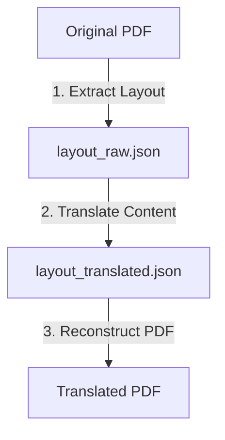

# PDF Translator Skill

Translate PDF documents while preserving their original visual layout, formatting, typography, colors, and styling using a modular extraction, translation, and reconstruction workflow.

## Core Architecture

Preserving PDF layout during translation is highly challenging due to:
1. **Punctuation and Line Wrapping:** English is space-separated, whereas Chinese characters are dense. Word wrapping rules differ.
2. **Font Compatibility:** Original fonts (e.g., Helvetica, Times-Roman) do not support CJK (Chinese, Japanese, Korean) characters. If used, CJK text displays as blank blocks.
3. **Background Preservation:** Covering original text requires erasing, but solid colors might cover images or patterns.

To solve this, this skill divides the translation task into three sequential phases:



This design allows:
- **High translation quality:** The AI agent translates the text in the structured JSON file block-by-block, maintaining semantic context and technical terms.
- **Visual refinement:** Users or the agent can edit the intermediate JSON file to tweak font sizes, alignments, or translation overrides before generating the final PDF.
- **Zero-polluting layout testing:** The reconstruction script dynamically calculates font sizes on virtual canvas documents before applying them to the final PDF.

---

## Workflow

### Step 1: Extract Layout Information
Run the layout extractor tool to parse text blocks, coordinates (`bbox`), sizes, and colors:
```bash
uv run skills/pdf-translator/scripts/extract_layout.py "{input_pdf}" "{output_json_dir}/layout_raw.json"
```

### Step 2: Translate Structured Content
Read `layout_raw.json`. For each page and each block:
1. Extract the `"text"` field.
2. Translate the text into the target language (e.g., Simplified Chinese).
3. **Term Consistency rules:**
   - Keep standard everyday technical terms intact (e.g., API, HTTP, JSON).
   - Use standard CJK terms for established concepts (e.g., database -> 数据库).
   - For obscure jargon, add the original English in parentheses only on first occurrence.
4. Inject the translated text into the JSON structure under a new key `"translated_text"`.
5. Save the updated file as `layout_translated.json`.

*Note: As an LLM-based agent, you can perform this step directly within your environment using your own model capability, ensuring highly contextual translation.*

### Step 3: Reconstruct PDF with Layout Matching
Run the reconstruction script to erase the original text bounding boxes, match the styling, auto-scale the fonts, and insert the target text:
```bash
uv run skills/pdf-translator/scripts/reconstruct_pdf.py "{input_pdf}" "{output_json_dir}/layout_translated.json" "{output_pdf}" --lang "{target_lang}"
```

---

## Technical Specifications

### 1. Font Selection
PyMuPDF (`fitz`) provides several high-quality built-in fonts. We map target languages to these built-in fonts to ensure zero external file dependencies:

| Target Language | Built-in Font Name | Font Style |
|:---|:---|:---|
| **Simplified Chinese (zh-CN)** | `china-ss` | HeiTi (Sans-serif) |
| **Simplified Chinese (Serif)** | `china-s` | SongTi (Serif) |
| **Traditional Chinese (zh-TW/HK)** | `china-ts` | MingLiU (Sans-serif) |
| **Traditional Chinese (Serif)** | `china-t` | SongTi (Serif) |
| **Japanese (ja)** | `japan-ss` | Gothic (Sans-serif) |
| **Japanese (Serif)** | `japan-s` | Mincho (Serif) |
| **Korean (ko)** | `korea-ss` | Gothic (Sans-serif) |
| **Korean (Serif)** | `korea-s` | Myungjo (Serif) |
| **Western Languages** | `helv` / `times-roman` | Helvetica / Times |

### 2. Font Shrink Loop (Auto-Fitting)
Because CJK translated text can vary in visual size compared to English source text:
- The reconstruction script starts checking with the **original block font size**.
- It creates a virtual single-page PDF memory space matching the block's bounding box coordinates.
- It attempts to render the text. If PyMuPDF reports text overflow (return value `< 0`), it reduces the font size by `0.5` points and retries.
- It stops when the text fits or when it hits the `--min-font-size` safety limit (default `6.0`).

### 3. Text Styling & Color Unpacking
Original PDF text colors are extracted as sRGB integers. The script unpacks them to float tuples:
$$r = \frac{(color\_int \gg 16) \& 255}{255.0}, \quad g = \frac{(color\_int \gg 8) \& 255}{255.0}, \quad b = \frac{color\_int \& 255}{255.0}$$
These colors are applied to the new textbox insertion, preserving exact text coloring.

---

## Review Checklist

Before finishing the PDF translation, verify the output document matches the checklist:
- [ ] **No overlap:** Ensure text fits in its column and does not overflow adjacent blocks.
- [ ] **Font CJK compatibility:** Ensure no question marks `?` or empty blocks `[]` representing missing font glyphs.
- [ ] **Erase perfection:** Verify no ghost original characters are visible behind the new translation text.
- [ ] **Alignment & Colors:** Verify headers retain their bold weights and distinct styling/colors.
- [ ] **Layout integrity:** Pages, columns, margins, and images should be perfectly preserved.
