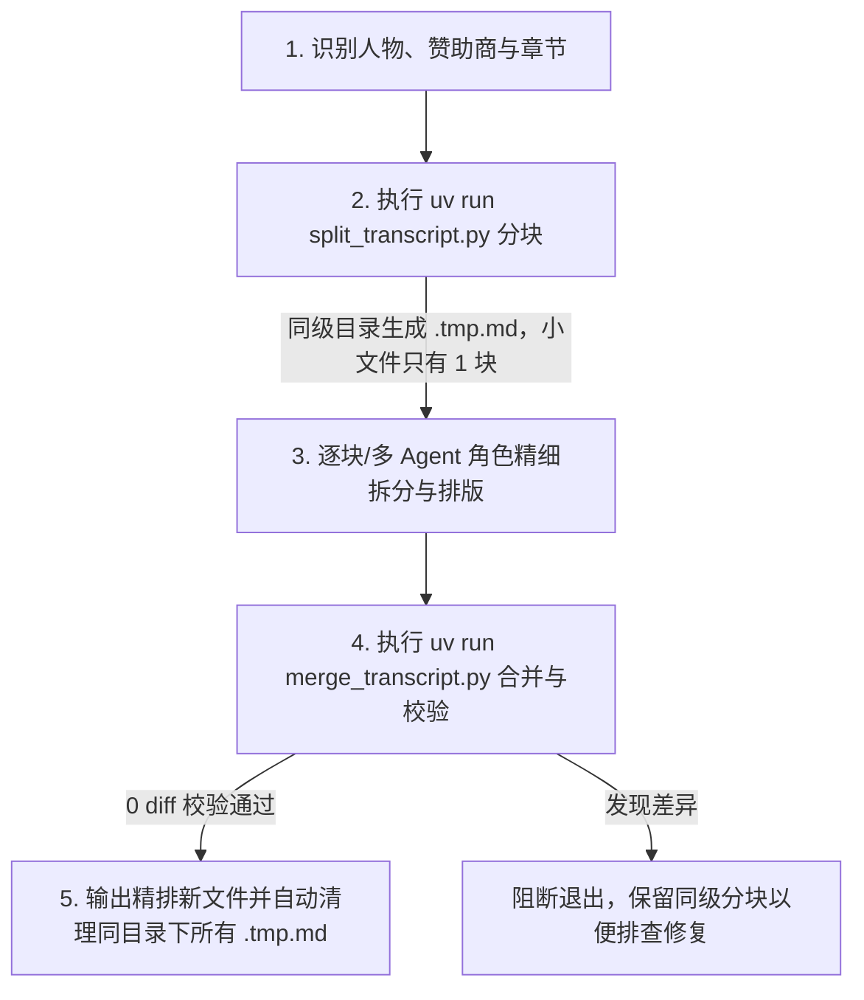

# Transcript Diarizer

精排访谈与播客逐字稿（Transcript Diarization）。将仅含有时间戳、多轮交替问答混杂在一起的原始字幕/逐字稿，精准拆解并归属为结构清晰的多角色对话（如主持人、嘉宾、赞助商口播），并保证 **100% 文本完全无损（0 diff）**。

---

## 核心执行铁律 (Non-negotiable Rules)

1. **强制使用 `uv` 运行 Python**：
   - 必须通过 `uv run` 执行所有 Python 脚本或单行命令（例如 `uv run scripts/...` 或 `uv run python -c "..."`）。
   - **严禁**直接调用裸 `python` 或 `python3` 命令。
   - 文中脚本路径均相对于本技能目录（即 SKILL.md 所在目录）。
2. **临时文件同级就地存储 (Colocated Temporary Files)**：
   - 所有中间分块文件（如 `.preamble.*.tmp.md`、`.part01.*.tmp.md` 等）**必须且只能存放在待处理源文件所在的同级目录下**（即 `target_file.parent`）。
   - **严禁**将临时文件散落在工作区根目录（`/Users/jiaming/notebook`）、系统 `/tmp` 或 Subagent 外部临时目录。
3. **100% 文本无损（0 diff）**：
   - 绝不删减、概括任何文字、标点、专业术语或语气助词（如 `［笑声］`、`［嗤笑］`、`［音乐］`）。合并后必须通过自动化校验。

---

## 工作流概览 (Workflow)



---

## 详细执行步骤

### 步骤 1：角色与前置信息识别 (Context Analysis)
在处理逐字稿正文前，必须先查看文档的前置区域（YAML Frontmatter、介绍文案、目录）：
1. **主持人 (Host)**：确定主持人姓名（如 `格尔盖伊·奥罗斯 (Gergely Orosz)`、`Dwarkesh Patel` 等）。
2. **嘉宾 (Guest)**：确定一位或多位嘉宾姓名（如 `凯西·穆拉托里 (Casey Muratori)`、`Mitchell Hashimoto` 等）。
3. **赞助商 / 口播 (Sponsors)**：记录文中出现的赞助商名称（通常由主持人单独念出，如 Antithesis、Sentry 等）。
4. **章节标题格式**：核查文章包含多少个章节，确认时间轴格式。

---

### 步骤 2：分块 (Chunking)

**无论文件大小都先运行分块脚本**——合并与无损校验依赖它生成的分块文件。脚本在**源文件所在目录下**生成临时分块，每 5 个章节一块；小文件只会生成 1 块：

```bash
uv run scripts/split_transcript.py "{file_path}" --chapters 5
```

- 该脚本将自动在 `{file_path}` 所在目录生成：
  - `{stem}.preamble.zh.tmp.md`：前导 Frontmatter、视频嵌入、赞助商文字介绍与目录。
  - `{stem}.part01.zh.tmp.md`、`{stem}.part02.zh.tmp.md` 等：每 5 个章节对应的正文分块。
- 逐字稿正文从二级标题（如 `## 逐字稿`、`## 访谈实录（全文）`、`## Transcript`）之后开始，标题后缀不限；没有章节标题时按 `**M:SS** ·` 时间戳分块，两者都没有时整篇正文作为 1 块。

---

### 步骤 3：逐块精细角色拆分 (Diarization Rules)

可启动多个并行 Subagent 或顺序逐块处理，修改同目录下的各 `part` 分块（或保存为 `.part*.diarized.zh.tmp.md`），遵循以下规范：

#### 1. 章节标题格式
- 统一使用三级标题，章节之间以 `---` 分隔：
  ```markdown
  ### 00:00 - 章节名称
  ```

#### 2. 发言人格式
- **纯净发言人标签（不保留时间戳）**：对话者姓名后**不保留时间戳**，统一使用纯加粗姓名加冒号的格式：
  ```markdown
  **格尔盖伊·奥罗斯**：...
  **凯西·穆拉托里**：...
  ```
  时间轴信息统一由各章节标题（`### 00:00 - 章节名称`）承载，正文各轮对话者均使用纯净的 `**姓名**：` 格式，不再在名字后追加 `[MM:SS]`。
- **同段落内多轮交替发言切分（核心难点）**：
  原字幕常将“主持人提问 + 嘉宾回答”或“插话”揉在同一个时间戳段落中。**必须精准识别并在句级进行换行切分**。切分出的后续发言同样使用纯加粗姓名：
  ```markdown
  **格尔盖伊·奥罗斯**：...游戏通常运行在相当高的分辨率下，你必须与它进行协调。

  **凯西·穆拉托里**：没错，就是 Windows NT 那个时期。

  **格尔盖伊·奥罗斯**：那是在 3.1 之后吗？

  **凯西·穆拉托里**：我想它是叫 NT 3.51。
  ```
- **赞助商与旁白归属**：中插口播若为主持人口播，统一归属为 `**主持人姓名**：`。

#### 3. 文本 100% 绝对无损原则
- **绝不删减、概括或缩写任何字词**。
- **保留所有语气标记与助词**：如 `［笑声］`、`［音乐］`、`［嗤笑］`、`[laughter]` 等。
- **保留所有英文术语与技术概念**：如 SIMD、load-store unit、L1/L2 cache 等。

---

### 步骤 4：自动化合并与无损校验 (Merge & Verification)

处理完毕各分块后，使用合并脚本进行自动化组装、`0 diff` 强制校验与临时文件清理：

```bash
uv run scripts/merge_transcript.py "{original_file_path}"
```

- 该脚本将自动：
  1. 组装同目录下的 preamble 与各分块，正文标题升级为 `## 访谈实录 (Transcript)`。
  2. 规范章节间的 `---` 分隔线。
  3. 更新 Frontmatter 中的 `title`（加上 `(精排对话版)`）。
  4. 生成新文件：`{原文件名} (精排对话版).zh.md`（保存在同一目录下，**不覆盖原稿**）。
  5. 调用 `verify_lossless.py`，使用 Python `difflib.SequenceMatcher` 逐字符比对原稿与精排稿的纯文字符流。
  6. **校验与清理**：
     - 若 **100% 文本无损 (0 diff)**：报告通过，并**自动清理该目录下所有 `{stem}*.tmp.md` 临时文件**。
     - 若发现任何文字差异：**抛出错误中断并完整保留各分块**以供人工/排查修复。

---

## 质量核查清单 (Review Checklist)

在向用户交付精排稿前，确认满足以下全部条件：
- [ ] 所有脚本与 Python 指令均使用 `uv run` 执行。
- [ ] 所有临时文件均存放在待处理文件同级目录下，且校验通过后已自动清理。
- [ ] 原文件未被改动，输出文件带有 `(精排对话版)`。
- [ ] 自动化校验报告 `[PASSED] 100% 文本无损对齐 (0 diff)`。
- [ ] 原始时间戳标签（如 `**0:00** ·`）全部被替换为角色标签，且对话者姓名后不保留时间戳（统一使用纯净的 `**姓名**：` 格式）。
- [ ] 同一时间戳内的多轮交替对话已被切分为独立段落。
- [ ] 章节标题统一为 `### MM:SS - 标题` 格式，章节间有 `---` 分隔。
